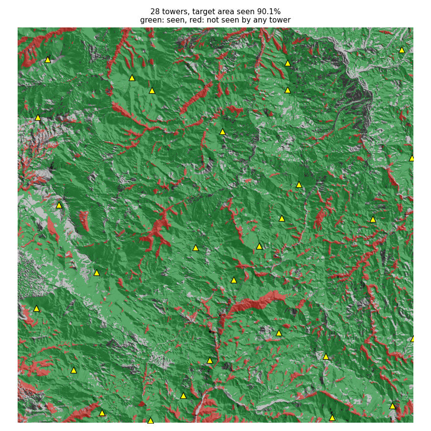

# Fire Tower Placement

Finds the fewest fire lookout towers, and where to put them, so that a target area (forest)
is seen from at least one tower. Input is a DEM; visibility is real line of sight computed
with GDAL's viewshed, and the towers are chosen with a greedy set-cover algorithm.



*Example: 1088 x 1088 cells (30 m) near Mugla, Turkey. 20 m towers, 15 km range, smoke 10 m
above ground must be visible. 28 towers see 90.1% of the forest (green); red is forest no
tower sees.*

## How it works

1. **Candidates** — every local summit (15 x 15 cell window) plus a regular grid
   (every 36 cells), so no part of the sheet depends on having a convenient peak.
2. **Viewshed per candidate** — `gdal.ViewshedGenerate` with tower height, target height,
   maximum distance and earth curvature/refraction. Each result is reduced to the target
   cells and bit-packed (1,700 candidates on a 1088² sheet: under a minute, ~250 MB).
3. **Greedy set cover** — repeatedly add the candidate that sees the most target cells not
   yet seen, until the goal share is reached (or a tower would add almost nothing).
   Minimum set cover is NP-hard; greedy is the standard approximation (within ln n of the
   optimum).
4. **Pruning** — drop towers that later choices made redundant.

The report also states how much of the target is visible from *any* candidate, so an
unreachable goal (deep valley floors) is visible instead of silently missed.

## Install

GDAL 3.1+ with Python bindings, NumPy 2, SciPy, Matplotlib.

- **Windows:** install [QGIS](https://qgis.org); `run.bat` finds its Python and GDAL.
- **conda:** `conda install -c conda-forge gdal numpy scipy matplotlib`

```bash
git clone https://github.com/erhanerogluant/fire-tower-placement.git
cd fire-tower-placement
run.bat -m unittest discover -s tests -v        # or: python -m unittest ...
```

## Usage

```bash
# example data (about 10 MB, downloaded from open cloud-optimised GeoTIFFs)
run.bat scripts/prepare_example_data.py

run.bat -m firetower --dem data/dem.tif --mask data/forest.tif \
        --tower-height 20 --target-height 10 --max-distance 15000 --goal 0.9 --out results
```

| Option | Default | Meaning |
|---|---|---|
| `--dem` | required | Elevation raster in a projected CRS (metres) |
| `--mask` | whole DEM | Target area raster on the same grid as the DEM |
| `--mask-values` | any non-zero | Mask values that count as target (e.g. `10` for WorldCover trees) |
| `--green-color` | off | Mask is an RGB colour map (scanned/exported sheet); green areas are the target |
| `--tower-height` | 20 | Observer height above ground (m) |
| `--target-height` | 0 | Height above ground that must be visible: 0 = the surface, e.g. 10 = smoke |
| `--max-distance` | 15000 | Detection range (m) |
| `--goal` | 0.9 | Share of the target area to see |
| `--max-towers` | none | Upper limit on towers |
| `--grid-step`, `--summit-window` | 36, 15 | Candidate density (cells) |

A mask on a different grid is rejected; align it first with `gdalwarp` (the message shows
how). Results in `--out`:

- `towers.geojson` — tower points with elevation and the share of the target each adds
- `coverage.tif` — per target cell, how many towers see it (0 = unseen)
- `summary.json` — counts, coverage, reachable share, parameters
- `map.png` — hillshade with seen / unseen target and the towers

## Results on the example sheet

`scripts/compare_legacy.py` also re-runs the earlier version of this project, which took
the highest cell of each 300 x 300 block (see [docs/HISTORY.md](docs/HISTORY.md)):

| Must be visible | Earlier script (14 towers) | Same 14 towers, viewshed-based | Towers for 90% | Towers for 95% |
|---|---|---|---|---|
| Ground surface (0 m) | 60.7% | 69.8% | 58 | 106 → 94.3% |
| Smoke at 10 m | 72.5% | 80.8% | 28 | 50 |

Seeing *every* surface is not realistic in rugged terrain: even all 1,707 candidates
together see 99.3% of the ground surface. Planning normally targets smoke above the canopy.

## Limitations

- Tower height, range and target height are assumptions; check them against the forest
  authority's criteria.
- Terrain outside the sheet is ignored, so edges get extra towers; use a DEM with a few km
  of buffer around the area of interest.
- The DEM is a surface model (Copernicus GLO-30 includes canopy); for bare-earth analysis use
  a DTM.
- Access roads, land ownership and existing towers are not considered.

## Data credits

Example data: Copernicus DEM GLO-30 (© DLR e.V. 2010–2014 and © Airbus Defence and Space GmbH
2014–2018, provided under COPERNICUS by the European Union and ESA) and ESA WorldCover 10 m
2021 v200 (CC BY 4.0).
